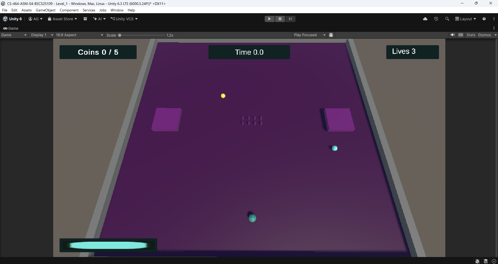
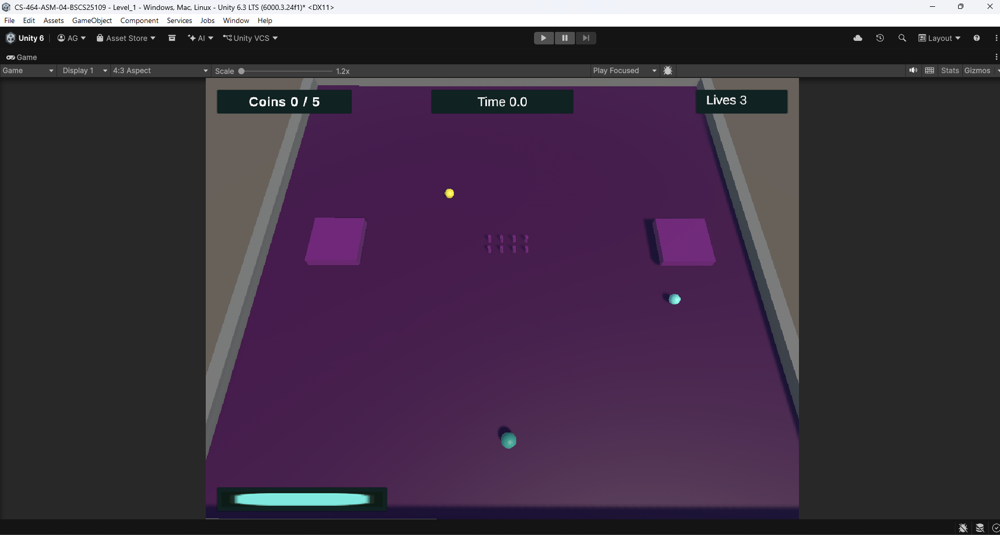
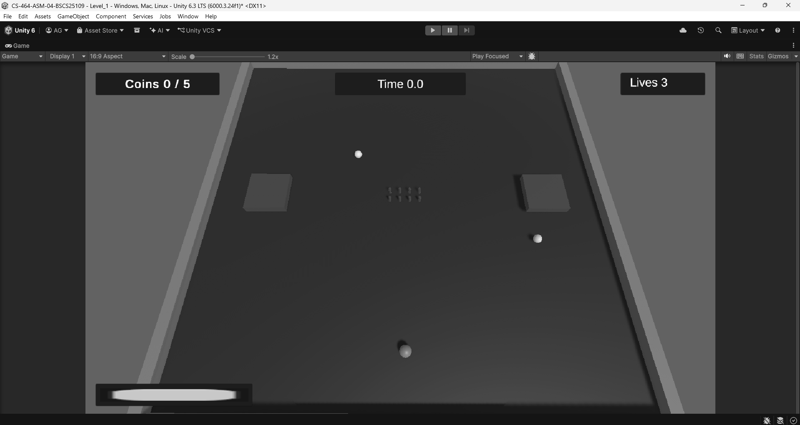

# CS464 Assignment 04 · Muhammad Abu Bakar · BSCS25109

**Video :** https://drive.google.com/file/d/1JBzpAhYWqTwYMkdfERqWE1-XZMXaqys5/view?usp=sharing

Started from my Assignment 03 repo (the five levels), copied with its history. Scenes: MainMenu 0, Level_1 to Level_5 at 1 to 5, Credits 6.

## Settings

| Part | Setting | Value | Why |
|---|---|---|---|
| A | Harmony · base hue | triadic · 174° | Teal base. Magenta (294°) and yellow (54°) are the other two, used for hazards and pickups. |
| A | Dark · mid · light | #182B29 · #3C9E94 · #E9F7F6 | Far apart in grayscale (28, 8F, F4), so it still reads without colour. |
| A | Accents | #FFED4D · #762080 | Yellow for pickups and score (bright in gray), purple for hazards (dark in gray). |
| A | HUD text on its panel | 13.48 : 1 | #E9F7F6 on #182B29, measured. Warning text is 7.68 : 1, score is 12.34 : 1. |
| A | Dark label on the button | 5.51 : 1 | #0F1A18 on #3C9E94. White would only be 3.23 : 1. |
| B | Music · SFX groups, as mixed | −8 dB · −2 dB | So effects stand out over the music. Exposed as MusicVolume and SfxVolume. |
| B | Slider at 1 · 0.5 · 0.0001 | 0 dB · −6 dB · −80 dB | Log10(value) × 20. Min is 0.0001 since Log10(0) breaks. |
| C | Hum, in Level 2 | Logarithmic · Min 1.5 m · Max 12 m | Small machine, so a natural fade. Max is about half the arena. |
| C | Beacon, in Level 5 | Linear · Min 2 m · Max 20 m | It marks the exit. Linear is silent at Max and rises steadily, like a compass. |
| C | AudioListener | on the player (empty object with ListenerOnPlayer) | My camera is high above the arena, so distance would be measured from the sky. |
| D | unlocked | int · default 1 | New game = only Level 1 open. |
| D | best1 … best5 | float · HasKey first | A missing time reading as 0 would beat every real time. |
| D | MusicVolume | float · default 1 | Missing key should mean full volume, not silence. |

## Answers

1. **What `Time.timeScale = 0` stops in my game, and what it doesn't:** It freezes enemies, the countdown, physics, coins and hazards. Update still runs, so PlayerController returns early when PauseMenu.IsPaused is true. Audio isn't stopped by it: AudioListener.pause mutes 3D sounds, while music and clicks ignore it so the sliders stay audible while paused.

2. **What survives a LoadScene in my game, and how:** DontDestroyOnLoad objects, statics and PlayerPrefs. My AudioSystem prefab is in every scene and its singleton check destroys extra copies. Time.timeScale, AudioListener.pause and IsPaused survive too, so I call Resume() before every load. Unlocks, best times and volumes are saved in PlayerPrefs, only through SaveData.

3. **Why every PlayerPrefs read in my game has a default:** A key doesn't exist until it's saved, like on a first run or after Clear All PlayerPrefs. Without defaults, GetInt gives 0 and locks Level 1, and GetFloat gives silence or a best time of 0. So unlocked and volumes default to 1, and best times check HasKey.

4. **An exception a forgotten unsubscribe would throw, and why mine can't:** The event keeps a reference to each listener. Without -= in OnDisable, a restart destroys the bar but leaves its listener, and the next Damaged call throws a MissingReferenceException. Mine can't: every listener uses += in OnEnable and -= in OnDisable.

## Credits

- All 8 sounds (pickup, hit, button, win, lose, music loop, hum, beacon) · generated from sine waves by generate_audio.py, written with help from AI · this repository · CC0

